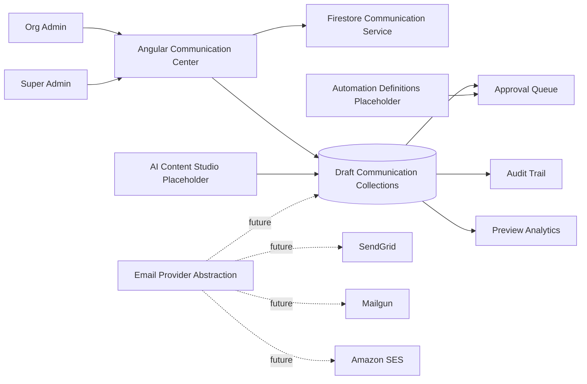

# Innovacare Communication Center Foundation

## Scope

Current safe slice implements Firestore-backed draft persistence only:

- draft-only communication workspace
- Firestore-backed newsletters, campaigns, segments, templates, approvals and audits
- preview/mock-only content and analytics
- org-scoped access for org-admin
- global read/write oversight for super-admin
- no live delivery provider integration
- no mutation of users, enrollments, certificates, billing or LMS collections

## Architecture Diagram

## Firestore Schemas

Canonical draft schemas live in [src/app/features/communication-center/contracts/communication.models.ts](src/app/features/communication-center/contracts/communication.models.ts).

Collections:

- communication_templates
- newsletters
- newsletter_campaigns
- newsletter_recipients
- newsletter_events
- newsletter_analytics
- communication_segments
- communication_automations
- communication_approvals
- communication_audits

All collections are:

- org-scoped with orgId required
- draft-only via safety.mode == draft_only
- mock-only via safety.mockOnly == true
- provider-disconnected via safety.provider == none

## Angular Module Structure

- communication-center.routes.ts
- communication-center.page.ts
- pages/communication-dashboard.page.ts
- pages/newsletter-builder.page.ts
- pages/campaigns.page.ts
- pages/audience-builder.page.ts
- pages/ai-content-studio.page.ts
- pages/approval-queue.page.ts
- pages/analytics.page.ts
- data/communication-center.service.ts
- data/communication-center.repository.ts
- data/newsletter.repository.ts
- data/campaign.repository.ts
- data/segment.repository.ts
- data/template.repository.ts
- data/communication-approval.repository.ts
- data/communication-audit.repository.ts
- contracts/communication.models.ts

## Cloud Functions Structure

Planned next phase only, not implemented in this foundation:

- createNewsletterDraft
- generateAINewsletter
- scheduleCampaign
- sendCampaignBatch
- trackOpen
- trackClick
- processBounce
- generateMonthlyOrgReport
- generateWeeklyLearnerDigest

Safe implementation rule for next phase:

- every function requires orgId scope resolution
- provider execution stays disabled until approval and provider abstraction are wired
- send functions operate on communication_* collections only

## AI Agent Design

Draft-only agent intents:

- weekly learner digest
- monthly organization report
- course announcements
- certification congratulations
- study reminders
- exam readiness campaigns
- learner reactivation campaigns

Governance requirements:

- persist promptVersion
- persist modelVersion
- persist approval record
- persist audit log
- keep rollbackReference for promoted revisions

## Email Provider Architecture

Provider abstraction contract:

- queueBatch
- retryFailedBatch
- processBounce

Provider targets:

- SendGrid
- Mailgun
- Amazon SES

Delivery safety for Phase 1:

- provider fixed to none
- no queue execution path
- no webhook listener activation

## Analytics Architecture

Source documents:

- newsletter_events for open, click, unsubscribe, bounce and preview signals
- newsletter_analytics for aggregated KPI snapshots
- communication_audits for AI and approval governance context

Executive KPIs:

- Communication Health Score
- Engagement Score
- Newsletter Performance
- Top Campaigns
- Revenue Attribution
- AI Generated Content Metrics

## Security Model

Access policy:

- learner: denied
- guest: denied
- org-admin/program-admin active membership in orgId: allowed within own org scope
- super-admin: allowed across all orgs

Firestore rules now enforce:

- orgId on every communication document
- draft_only mode on every communication document
- mockOnly true on every communication document
- newsletters cannot transition to sent
- campaigns cannot transition to scheduled without a prior approved state
- learner and guest access remains denied for admin communication collections

## Firestore Persistence Status

Persisted collections in this slice:

- newsletters
- newsletter_campaigns
- communication_segments
- communication_templates
- communication_approvals
- communication_audits

Indexes added for this slice:

- newsletters by orgId/status/updatedAt and orgId/createdBy/updatedAt
- newsletter_campaigns by orgId/status/scheduledAt and orgId/newsletterId/createdAt
- communication_segments by orgId/status/updatedAt
- communication_templates by orgId/type/status/updatedAt
- communication_approvals by orgId/status/priority/createdAt
- communication_audits by orgId/entityType/entityId/createdAt
- newsletter_events by orgId/campaignId/createdAt
- newsletter_recipients by orgId/campaignId/status/updatedAt

## Test Commands

- npm run test:communication:smoke
- npm run test:communication:persistence
- npm run typecheck

## Known Limitations

- no real email provider integration
- no live send path
- no AI auto-send path
- no production automation execution
- approval decisions remain read-only in the UI

## Next Safe Step

Add controlled draft creation and update actions in the Angular UI while keeping provider execution disabled.

## RBAC Matrix

| Role | Read own org drafts | Create/update own org drafts | Cross-org read | Cross-org write |
| --- | --- | --- | --- | --- |
| guest | no | no | no | no |
| learner | no | no | no | no |
| org_admin/program_admin | yes | yes | no | no |
| super_admin | yes | yes | yes | yes |

## Implementation Roadmap

1. Foundation: shell, contracts, rules, mock data, smoke tests
2. Draft workflow: richer editor, template manager, automation designer
3. AI governance: prompt versioning, approval routing, rollback states
4. Provider integration: EmailProvider adapters and queued delivery
5. Attribution: event ingestion and cross-module conversion mapping

## Sprint Breakdown

Sprint 1:

- contracts and collection schemas
- shell and draft pages
- rules and smoke tests

Sprint 2:

- template manager
- automation designer
- audience builder persistence

Sprint 3:

- AI draft generation callables
- approval workflow persistence
- audit enrichment

Sprint 4:

- provider adapters
- webhook events
- executive reporting

## Cost Estimation

Phase 1 foundation:

- Firestore reads/writes minimal, mock-only
- no provider cost
- no Cloud Run delivery cost

Phase 2+ planning assumptions:

- provider costs scale by sends and validation volume
- Firestore analytics aggregation may require scheduled compaction
- Cloud Functions v2 batch delivery should budget for queue fan-out and retries

## Scalability Plan

- keep audiences materialized into communication_segments snapshots before provider fan-out
- separate newsletter_recipients from newsletters to avoid oversized campaign docs
- aggregate analytics into newsletter_analytics rather than querying raw events for dashboards
- use approval queue and audits as immutable workflow boundaries
- keep delivery adapters behind EmailProvider to avoid coupling UI or campaign data to a single vendor