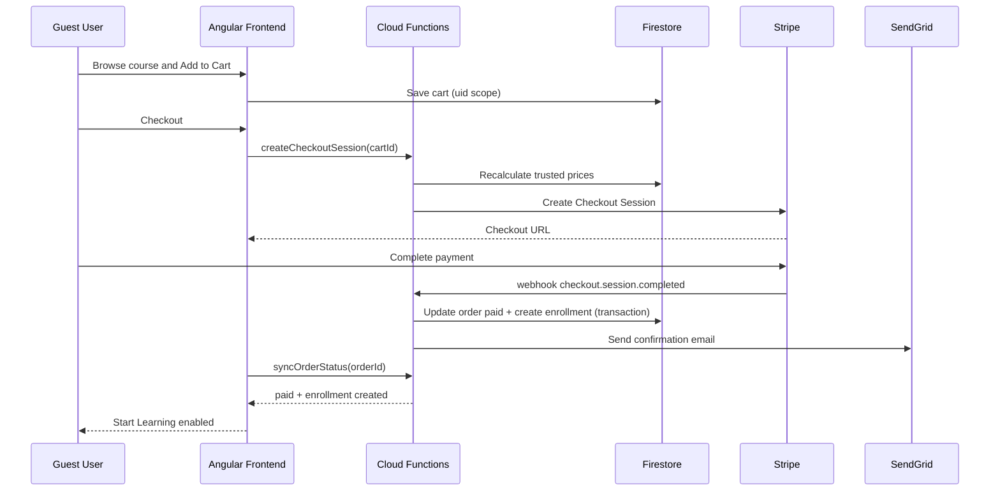

# Workflow LMS Guest -> Purchase -> Enrollment -> Learning

## 1) Objectif
Mettre en place un flux LMS real-world, securise et traçable:
1. Le guest arrive sur le site
2. Il consulte un cours public
3. Il ajoute au panier
4. Il passe au checkout
5. Paiement Stripe reussi
6. Enrollment cree automatiquement
7. Le learner demarre son cours (ou section live)

## 2) Principes de securite (obligatoires)
- Zero trust cote client: aucune operation sensible ne doit dependre uniquement du front.
- Toutes les operations critiques passent par Cloud Functions (HTTPS callable + webhook Stripe).
- Verification serveur des prix, devises, IDs cours, eligibilite, et ownership utilisateur.
- Idempotence sur les paiements et enrollments pour eviter doublons.
- Segregation stricte des donnees par `uid` (Firestore/Storage Rules).
- Journalisation de securite + traces d'audit pour chaque etape critique.
- Rate limiting + anti-abus (reCAPTCHA Enterprise ou equivalent sur endpoints sensibles).

## 3) Parcours fonctionnel cible
### A. Guest browse
- Collection publique `courses` avec champs exposes uniquement necessaires.
- Page catalogue/public details accessible sans auth.
- CTA: `Add to Cart`.

### B. Cart (guest-friendly)
- Panier local temporaire (session/local storage) si non connecte.
- A la connexion/inscription: merge panier local -> panier utilisateur Firestore.
- Le panier persiste dans `carts/{uid}`.

### C. Auth + profil avant paiement
- Si user non connecte au checkout: forcage login/register.
- Si profil incomplet: wizard profil minimal obligatoire (nom, pays, consentement policy).
- Email verification obligatoire avant paiement eleve risque (option configurable).

### D. Checkout Stripe
- Front appelle Cloud Function `createCheckoutSession` avec `cartId`.
- Function:
  - recharge les cours depuis Firestore (prix server-side)
  - refuse prix fournis par le client
  - cree Stripe Checkout Session
  - stocke `orders/{orderId}` en statut `pending_payment`
- Front redirige vers Stripe Hosted Checkout.

### E. Confirmation paiement (webhook)
- Stripe webhook `checkout.session.completed` traite par Cloud Function.
- Function verifie signature webhook + idempotence via `event.id`.
- Si valide:
  - passe la commande en `paid`
  - cree `enrollments/{uid}_{courseId}` si absent
  - initialise progression
  - emet notifications (SendGrid + in-app)

### F. Post-purchase UX
- Front page success appelle `syncOrderStatus(orderId)`.
- Dashboard guest/learner affiche les nouveaux enrollments.
- User clique `Start Learning` -> player.

### G. Live sections
- Scheduling et controles via Cloud Functions + documents `liveSessions`.
- Rules interdisent tout join sans enrollment actif.
- Tokens temporaires (ex: Twilio/Zoom/Agora) generes server-side uniquement.

## 4) Modele de donnees (minimum)

## collections
- `users/{uid}`
  - role: `guest | learner | manager | superAdmin`
  - status: `active | blocked`
  - emailVerified: boolean
  - profileCompleted: boolean

- `courses/{courseId}`
  - active, title, price, currency, visibility, sections

- `carts/{uid}`
  - items: [{ courseId, qty }]
  - updatedAt

- `orders/{orderId}`
  - uid
  - itemsSnapshot (prix figes)
  - amountTotal
  - currency
  - stripeSessionId
  - status: `pending_payment | paid | failed | refunded`
  - createdAt, paidAt

- `enrollments/{uid}_{courseId}`
  - uid, courseId
  - orderId
  - state: `active | completed | revoked`
  - progressPct
  - currentLessonId
  - completedLessonIds

- `notifications/{uid}/items/{notifId}`
  - type, title, payload, sentAt, read

- `auditLogs/{logId}`
  - action, uid, ipHash, uaHash, resource, outcome, timestamp

## 5) Cloud Functions requises
1. `createCheckoutSession` (callable/https)
2. `stripeWebhook` (https raw body)
3. `upsertEnrollmentFromOrder` (internal helper transaction)
4. `sendTransactionalEmail` (SendGrid adapter)
5. `syncOrderStatus` (client-safe status fetch)
6. `createLiveJoinToken` (live session gatekeeper)
7. `onUserCreateBootstrapProfile` (Auth trigger)

## 6) Regles Firestore (strategie)
- `users/{uid}`: lecture/ecriture uniquement proprietaire + admins.
- `carts/{uid}`: uniquement proprietaire.
- `orders/{orderId}`: lecture proprietaire, aucune ecriture client sur statut.
- `enrollments/{uid}_{courseId}`: lecture proprietaire; ecriture server-only.
- `courses`: lecture publique sur cours actifs; ecriture admin-only.
- `auditLogs`: write server-only, read admin-only.

## 7) Regles Storage (strategie)
- Materiels publics cours: lecture publique si necessaire.
- Uploads user (avatars, devoirs): `uid` scope strict.
- Assets premium: URL signee/tokenisee ou mediation backend.

## 8) Notifications multicanales
- Email: SendGrid (purchase confirmation, enrollment created, reminder).
- In-app: `notifications/{uid}`.
- Option SMS/WhatsApp: provider additionnel (feature flag).

## 9) Controles anti-fraude et conformite
- Webhook signature validation Stripe.
- Idempotency keys sur create session + webhook processing.
- Verrou transactionnel Firestore pour order->enrollment.
- Sanitize + schema validation (zod/joi) sur payloads entrants.
- Secrets via Firebase/Google Secret Manager.
- Monitoring + alerting sur erreurs webhook et ecarts de conversion.

## 10) Workflow de securite applicative (checklist)
- [ ] Authentication et email verification actifs
- [ ] RBAC et guards verifies par role
- [ ] Firestore rules testees (emulator tests)
- [ ] Storage rules testees
- [ ] Endpoints function testes pour authz
- [ ] Stripe test cards + replay webhook testes
- [ ] Logs d'audit et correlation IDs actifs
- [ ] Limitation de debit sur endpoints sensibles

## 11) Tests E2E obligatoires
1. Guest browse -> add to cart -> login -> pay -> enrollment cree
2. Tentative de forger prix cote client -> rejet serveur
3. Replay webhook Stripe -> pas de doublon enrollment
4. User A tente lire enrollment User B -> refuse par rules
5. Section live sans enrollment -> join refuse
6. Payment failed -> pas d'enrollment cree

## 12) Decoupage implementation (ordre recommande)
### Sprint 1: Secure checkout backbone
- Cloud Function createCheckoutSession
- Stripe webhook + orders + enrollment transaction
- Rules Firestore de base

### Sprint 2: UX onboarding + profile gate
- Merge panier local/compte
- Wizard profil obligatoire
- Email verification gate

### Sprint 3: Notifications + live workflow
- SendGrid templates
- in-app notifications
- Live join token via function

### Sprint 4: Hardening
- Test suite rules/functions
- Audit logging complet
- Monitoring alerting

## 13) Sequence diagram (Mermaid)

## 14) Definition of Done (production)
- Aucun enrollment cree sans paiement valide.
- Aucun prix client accepte sans recalcul serveur.
- Toutes les donnees learners isolees par uid.
- Webhooks idempotents et audites.
- Parcours complet E2E vert en environnement staging.
